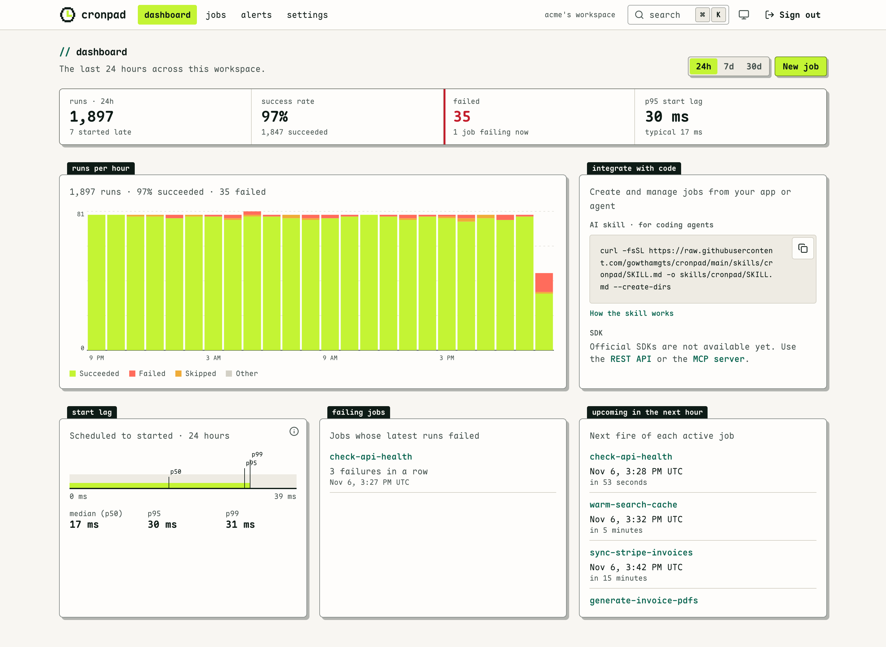

# cronpad

A durable cron scheduler for webhooks and commands, in one Go binary. It serves the
API, the dashboard and an MCP server, and stores everything in SQLite. There is no
Postgres, Redis or message broker to run.

Every run records when it was scheduled, claimed, started and finished, so "how
late was my 09:00 job?" has an exact answer.

<picture>
  <source media="(prefers-color-scheme: dark)" srcset="docs/screenshots/dashboard-dark.png">
  
</picture>

## Try it

On your machine, with development login (never enable this on a server other people can reach):

```sh
mkdir cronpad && cd cronpad
curl -fsSLO https://raw.githubusercontent.com/gowthamgts/cronpad/main/docker-compose.yml
printf 'CRONPAD_AUTH__DEV_LOGIN=true\nCRONPAD_SECRETS__ENCRYPTION_KEY=%s\n' "$(openssl rand -base64 32)" > .env
docker compose up -d
# Open http://localhost:8080/
```

Or sign up for a free hosted account at [cronpad.com](https://cronpad.com): no
credit card, 50 jobs and 50,000 runs a month.

## What you get

- **Schedules people can read.** Cron (5 or 6 fields), Quartz (`L`, `W`, `#`),
  RFC 5545 RRULE, one-off timestamps or plain English such as
  `second tuesday of every month at 9am`, each in an explicit IANA timezone with
  documented daylight-saving rules. Preview the next fire times before you save.
- **A receipt for every run.** Four timestamps per run, start lag on the
  dashboard, and an alert when a job starts later than a threshold you set.
- **Retries and alerts.** Backoff policies, auto-disable for jobs that keep
  failing, and alerts by email or webhook.
- **Webhooks you can verify.** Requests are signed
  ([Standard Webhooks](https://www.standardwebhooks.com/)) and carry an idempotency
  key that stays the same across retries.
- **Built for agents too.** An MCP server, an agent skill, a CLI and a REST API
  with an [OpenAPI contract](api/openapi.yaml).
- **Durable on one disk.** Two SQLite files hold the state and can be streamed
  to any S3-compatible store by the bundled Litestream. The delivery queue is a
  third, rebuildable file: lose it and runs are delayed, not lost.

### How it compares

| Instead of | What cronpad adds |
|---|---|
| `crontab` on a server | Retries, alerts, run history, timezones, and jobs that survive the machine being replaced |
| A hosted cron service | The same thing as open source: self-host it with every feature, or use the hosted one |
| A queue or workflow engine | Much less to operate when all you need is "call this URL on a schedule, reliably" |

## Status

cronpad is young: the first release was in October 2026 and versions are still
`0.0.x`. It runs the hosted service at cronpad.com. Expect changes before 1.0, and
read the production checklist below before relying on it.

cronpad is developed with AI coding assistants, directed and reviewed by the
maintainer. Changes are checked by the test suite: queue conformance tests, API
contract tests against the OpenAPI spec, browser end-to-end tests and the load
test behind the numbers below.

If cronpad is useful to you, a star helps other people find it.

## Self-hosting

The image is `ghcr.io/gowthamgts/cronpad:latest` (or pin a version such as `0.0.5`).
The [self-hosting guide](https://cronpad.com/docs/get-started/self-hosted) walks
through `.env`, real sign-in (GitHub or Google) and your first job. Keep
`CRONPAD_SECRETS__ENCRYPTION_KEY`: stored secrets can't be decrypted without it.

Before relying on it, read the
[production checklist](https://cronpad.com/docs/self-hosting/production-checklist)
and [backup documentation](https://cronpad.com/docs/self-hosting/backups). Other
install methods (Docker, Kubernetes, binary) are in the
[installation guide](https://cronpad.com/docs/self-hosting/installation).

## Performance

Measured on an Apple M5 Pro (15 CPUs, 24 GiB RAM), using the real API and local
HTTP deliveries for 60 seconds in durable mode, with 256 loadgen workers and the
default group-commit result writer (the shipped worker-count default is 64).
Start lag is the time from the scheduled moment to the outbound request being sent.

| Mode | CPU budget | Successful runs/min | Start lag p50 / p95 / p99 |
|---|---|---:|---|
| Durable (default) | Default (15) | 12,000 | 37 / 49 / 54 ms |
| Durable (default) | 2 CPUs (`GOMAXPROCS=2`) | 12,000 | 43 / 58 / 60 ms |
| Fast (opt-in) | Default (15) | 12,000 | 28 / 37 / 39 ms |
| Fast (opt-in) | 2 CPUs (`GOMAXPROCS=2`) | 12,000 | 21 / 35 / 40 ms |
| Durable (default) | Default (15) | 30,000 | 67 / 115 / 139 ms |

The 12,000/min rows are the median of three 60-second runs each (each percentile
taken separately); single runs varied by up to `±10 ms`, and one two-CPU durable
run reached `p99` 89 ms.

SQLite + WAL (all three files) grew about 11 MB per 12,000 runs. A single job
firing once a second starts in 2–4 ms.

Every run recorded all successes and zero duplicates. Fast mode starts the
request before the admission commit lands, so a crash can repeat a delivery:
receivers must deduplicate by idempotency key.

At higher offered load (30-second runs, every job due in the same instant) the
same machine delivered all runs with zero duplicates: `p99` 111 ms at 30,000/min,
211 ms at 60,000/min and 393 ms at 120,000/min; spread across each second, `p99`
stayed at 2 ms.

These are local measurements, not a claim about a two-vCPU cloud VM or network
disks. See [storage](https://cronpad.com/docs/concepts/storage) for workload
details, durable vs fast mode and the janitor comparison. `just loadtest`
reproduces them against a local echo server.

## Development

Install Go, Node, pnpm and just, then run `just dev`. Use `just check` before
contributing; see [contributing](CONTRIBUTING.md). Release tools are version-pinned
in separate Go tool modules; `just release` builds archives, checksums and SBOMs.

To build and run the image from source instead:

```sh
export CRONPAD_AUTH__DEV_LOGIN=true CRONPAD_SECRETS__ENCRYPTION_KEY="$(openssl rand -base64 32)"
docker compose -f deploy/docker-compose.yml up --build
```

This stack also starts OTel Collector, Prometheus and Grafana. They are optional
development tooling, not app dependencies, and the Compose files in `deploy/` are
for **local development and testing only**. See
[development deployment samples](deploy/README.md).

## License

cronpad is licensed under AGPL-3.0; the full license is in [LICENSE](LICENSE).
Contributions are covered by the [CLA](CLA.md).

Self-hosting is free. The hosted service at [cronpad.com](https://cronpad.com) and
enterprise features are offered separately by the project owner.
